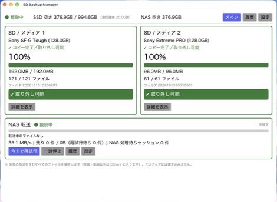

# SD Backup Manager

文化祭・学園祭の撮影データを、SD カード / USB メモリ / 外付け SSD・HDD から
**内蔵 SSD 経由で NAS に安全に取り込む** アプリです（Rust / Iced）。
**Windows 10/11（x64）** と **Ubuntu 26.04** に対応しています（Windows での読み替えは [docs/windows.md](docs/windows.md)）。

担当者はメディアを挿すだけ。アプリが自動で

1. メディアを検出し、**読み込み専用**で全パーティションを 1 セッションとして走査
2. SD の全ファイル・空フォルダを、元のフォルダ構成で `sd1/20261028112834/` のように内蔵 SSD にコピー（BLAKE3 で原本と照合）
3. 全パーティションを安全にアンマウントできたら **「取り外し可能」** を表示（緑＝全件成功 / 黄＝失敗あり）
4. 検証済みファイルから順に NAS（SMB）へ転送し、NAS 側も読み戻してハッシュ照合
5. セッションの全ファイルと `manifest.json` が NAS で検証できたときだけ SSD の一時データを削除

します。仕様は [docs/SD_Backup_Manager_Requirements_v1.0.md](docs/SD_Backup_Manager_Requirements_v1.0.md) を参照してください。

新規バックアップは毎回全ファイルを実体として保存します（複数パーティションは `P01/`・`P02/` に分けます）。
旧バージョンの履歴・分類済みフォルダは維持し、中断分は旧形式のまま再開します。
カード番号は自動登録します。SD/MMC 接続でカードのシリアルが取得できる場合はフォーマット後も同じ番号を使い、
取得できない USB リーダー等では、フォーマット後は新しいカード番号になります。リーダーのシリアルでカードを推測しません。

Windows の一時保存先は通常 `%USERPROFILE%\SDBackupStaging\sessions\sd1\日時\`。
メイン画面・設定の［PC 内の保存先を開く］、詳細の［この保存先を開く］から開けます。
NAS に全件保存・検証できたら PC 内の一時データは削除され、NAS の `sd1/日時/` に残ります。
読み込み権限のない項目は失敗として通知し、リンク・特殊ファイルは対象外です。ディスクイメージではなくファイル単位のコピーです。



## 絶対ルール（実装上の保証）

| ルール | 実装 |
|---|---|
| 元メディアを変更しない | 読み込みは `O_NOFOLLOW` の読み取り専用オープンのみ。UDisks2 で `ro` マウント。書き込み・修復・フォーマットのコードパスなし |
| NAS 検証前に SSD を消さない | 9.4 のガード条件をすべて満たすまで削除しない（`backup_core::policy::check_staging_deletion`） |
| 取り外し可能はアンマウント成功時のみ | `SlotPhase::removable()` は `DoneGreen` / `DoneYellow` だけ。アンマウント失敗は赤表示 |
| 未検証を成功扱いしない | `.part` → fsync → 読み戻しハッシュ → rename → 親 dir fsync の後に DB を更新 |
| 履歴だけでスキップしない | 元ファイルの再ハッシュと NAS 実体の再ハッシュが一致した場合のみ参照扱い |
| SSD 最低空き 20GB | セッション開始前の容量アドミッション + ファイル単位の確認 + 256MiB ごとの再確認 |

## 構成

```
crates/backup-core     ドメイン（状態遷移・分類・識別・パス安全化・マニフェスト・容量/削除ポリシー）
crates/backup-db       SQLite（WAL, synchronous=FULL）とマイグレーション
crates/backup-storage  BLAKE3・原子的コピー・容量・ステージング・NAS 転送・復元
crates/backup-device   UDisks2（Linux）/ Win32（Windows）/ メディアシミュレータ
crates/backup-ipc      JSON Lines プロトコル（Unix ソケット / Windows 名前付きパイプ）
crates/backup-config   設定 TOML・パス（XDG / %APPDATA%）・資格情報（Secret Service / 資格情報マネージャー）
apps/daemon            sd-backup-daemon（Linux: systemd --user、Windows: タスク スケジューラで常駐）
apps/gui               sd-backup-gui（Iced・日本語）
apps/cli               sd-backup（status / doctor / restore / export-logs ...）
```

詳しくは [docs/architecture.md](docs/architecture.md)。

## インストール（Windows 10/11 / x64）

[Releases](https://github.com/sangikousenuser/sd-backup-manager/releases/latest) から
`sd-backup-manager-setup-x64.exe` をダウンロードして実行します（管理者権限・開発環境は不要）。
インストール後に開く画面の［設定］で NAS を登録してください。詳しくは [docs/windows.md](docs/windows.md)。

## インストール（Ubuntu 26.04 / x86_64）

Ubuntu 側に Rust などの開発環境は不要です（GitHub Actions がビルドしたバイナリを配布しています）。
次のどちらかを選んでください（両方は入れないでください）。

**A. .deb パッケージ（おすすめ）** — 依存パッケージも apt が自動で入れます。

```bash
wget https://github.com/sangikousenuser/sd-backup-manager/releases/latest/download/sd-backup-manager_amd64.deb
sudo apt install ./sd-backup-manager_amd64.deb
```

`/usr/bin` にインストールされ、全ユーザーのログイン時にデーモンと GUI が自動起動します。
更新は新しい .deb を同じ手順で入れるだけ、削除は `sudo apt remove sd-backup-manager`
（設定・DB・SSD の一時データ・NAS・パスワードは削除しません）。

**B. 1 行インストール（ホームフォルダに入れる）**

```bash
curl -fsSL https://github.com/sangikousenuser/sd-backup-manager/releases/latest/download/install.sh | bash
```

バージョン指定は `... | bash -s -- --version v0.1.0`。インストーラは

- 成果物と `SHA256SUMS` を照合（不一致なら中止）
- 不足している依存パッケージ（udisks2, libglib2.0-bin, gvfs-backends, gvfs-fuse, gnome-keyring, fonts-noto-cjk ほか）を表示し、確認後に `sudo apt-get install`
- `~/.local/bin` にバイナリ、`~/.config/systemd/user` にサービス、`~/.config/autostart` に GUI を登録
- 更新時は既存の設定・DB を保持し、DB をバックアップしてから入れ替え

を行います。更新は `~/.local/share/sd-backup-manager/upgrade.sh v0.2.0`、
削除は `~/.local/share/sd-backup-manager/uninstall.sh`（データ・SSD 一時ファイル・NAS・パスワードは消しません）。

### 初回設定

GUI の［設定］で NAS を設定します。

1. 「SMB 共有」を選び、`smb://サーバー/共有名/フォルダ/`・ユーザー名・パスワードを入力
2. ［接続テスト］→［保存］（保存時に保存先識別ファイルを作成して接続先を固定します）
3. 管理者が CIFS を `/mnt/...` にマウント済みの場合は「マウント済みのパス」を選択

パスワードは GNOME キーリング（Secret Service）に保存され、設定ファイル・ログ・コマンドライン引数には出ません。

## 開発（macOS / Linux）

```bash
cargo test --workspace          # 単体テスト + E2E（シミュレータ + ローカル NAS）
cargo clippy --workspace --all-targets -- -D warnings
```

実機の SD カードや NAS がなくても、シミュレータで GUI ごと動かせます。

```bash
export SDBM_BASE_DIR=/tmp/sdbm-dev   # 設定・DB・ソケット・SSD 一時領域をここにまとめる
mkdir -p $SDBM_BASE_DIR/media $SDBM_BASE_DIR/nas
cargo run -p sd-backup-daemon -- --base-dir $SDBM_BASE_DIR \
  --simulate-media $SDBM_BASE_DIR/media --dev-nas-dir $SDBM_BASE_DIR/nas &
cargo run -p sd-backup-gui
# メディアの「挿入」: 中身を用意したディレクトリを media/ に移動
mkdir -p /tmp/card/p1/DCIM/100MSDCF && echo test > /tmp/card/p1/DCIM/100MSDCF/DSC0001.JPG
mv /tmp/card $SDBM_BASE_DIR/media/card1      # 抜去は media/card1 を移動/削除
```

シミュレータの書式は `crates/backup-device/src/sim.rs` を参照（`media.toml` で
シリアル・FS UUID、`.unmount-fail` でアンマウント失敗を模擬できます）。

## ドキュメント

- [docs/HANDOFF.md](docs/HANDOFF.md) — **引き継ぎ資料**（現状・構成・Windows での開発手順・未検証事項・次の作業）
- [docs/windows.md](docs/windows.md) — Windows 版（仕様の読み替え・インストール・注意点）
- [docs/architecture.md](docs/architecture.md) — 構成・状態遷移・データフロー
- [docs/security.md](docs/security.md) — 権限・資格情報・パス安全化
- [docs/operations.md](docs/operations.md) — 運用手順・トラブル対応・ログ
- [docs/acceptance.md](docs/acceptance.md) — 受け入れ試験 AT-01〜34 の実施状況と実機試験手順
- [CHANGELOG.md](CHANGELOG.md)

## ライセンス

MIT
