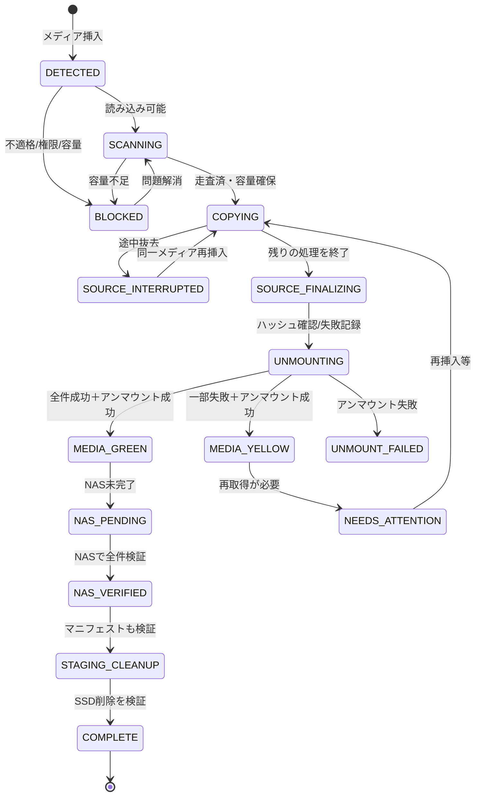

# SD Backup Manager — 最終要件定義・技術設計書 v1.0

> 作成日: 2026-10-15（JST）  
> 対象: 文化祭・学園祭の撮影済みデータを、リムーバブルメディアから内蔵SSD経由でNASに安全に取り込むためのUbuntu Desktop向け専用アプリ  
> ステータス: 第1〜7段階のユーザー回答反映済み／実装ベースライン  
> 実装言語: Rust（GUIはIced）  
> この文書の「採用方針」は、安全性・実装可能性のために追加した具体化項目であり、事前にユーザーが個別回答した事項と区別する。

---

## 0. 要約・最重要ルール

**ユーザー体験**：Ubuntuにログイン済みなら、担当者はSDカード／USBメモリ／外付けSSD・HDDを接続するだけでよい。最大2つの物理メディアを同時に認識・処理する。内蔵SSDに撮影データを保存し、ハッシュ検証が成功したファイルからNASに転送する。元メディアの読み込み・検証完了後、全パーティションの安全なアンマウントに成功してから「取り外し可能」を表示する。

**絶対ルール**：

1. **元メディア内のファイルを削除・改変しない。** 読み込み専用で扱い、フォーマット、修復、書き込みを自動実行しない。
2. **NAS側でセッション内の全対象ファイルが検証成功したことを確認するまで、そのセッションのSSDデータを自動削除しない。** 途中で失敗が残る場合も削除しない。
3. **「取り外し可能」の判定はNAS転送と独立**。SD→SSDの全読み込み処理を終了し、必要な検証を終え、全対象パーティションのアンマウントが成功して初めて表示する。
4. **全件成功（緑）と未完了・取り外し可能（黄）を厳格に区別**。3回再試行後の失敗が残ると黄色。安全なアンマウントが失敗すれば「取り外し可能」とは表示しない。
5. **電源断・OS再起動・NAS切断・メディア抜去からの復旧**を要件とする。未検証ファイルを成功扱いしない。
6. **同一メディアの再コピー回避は保存実体の確認が前提**。履歴だけでスキップしない。識別が不確かなメディアは安全側に倒す。
7. **内蔵SSD 256GB**：空き容量を常に最低20GB残す。2枚の128GBメディアが満杯なら、2枚分を内蔵SSD上に一括保持できる保証はない。NASの処理が追いつくよう順序制御し、必要なら2台目を待機させる。
8. **完全なカメラカードイメージを作る製品ではない。** Photos/Videos/Otherへの分類を優先し、元のパスと対応関係をマニフェストとして保持する。編集ソフトが純正カード構造を要求するケース向けの再構成手段を提供する。

---

## 1. 目的・想定利用

### 1.1 目的
- 文化祭当日に担当者が撮影カードを接続するだけで、映像・写真を確実に回収できる。
- 担当者にファイルコピー操作、NAS操作、フォルダ名入力を要求しない。
- NAS故障・一時ネットワーク断があっても撮影素材を失わない。
- コピー元・SSD・NAS間の整合性を検証し、誤った成功表示を防ぐ。

### 1.2 対象環境

| 項目 | 確定内容 |
|---|---|
| OS | Ubuntu Desktop 26.04 |
| CPU | Intel Core i5-6500T（4コアを想定） |
| 内蔵SSD | 256GB（利用可能容量は実測値を使用） |
| 代表的なSDカード | 128GB |
| NAS接続 | 有線LAN 1Gbps・SMB共有 |
| 言語 | Rust |
| GUI | Iced、シンプルな日本語UI |
| 起動 | Ubuntuユーザーログイン後にGUIとバックアップサービスを自動起動 |
| 接続メディア | SD、microSD、USBメモリ、USB外付けSSD、USB外付けHDD（SDリーダー含む） |
| 同時作業 | 最大2つの物理メディアを同時処理。追加分は待機キュー |
| 導入・更新 | GitHub配布のバージョン指定インストーラスクリプト |
| CI | GitHub Actionsで自動ビルド・テスト・成果物生成 |

**スコープ外（v1.0）**：クラウドへのアップロード、撮影データの編集・エンコード、動画プレビュー、ネットワーク公開Web UI、モバイルアプリ、メディアの自動初期化・自動消去、完全なディスクイメージ保存。

---

## 2. ユースケースと基本操作フロー

### 2.1 普段の操作
1. UbuntuにログインするとバックグラウンドサービスとIced GUIが自動起動。
2. GUIに「SD 1」「SD 2」の状態、NASの状態、内蔵SSD/NASの空き容量が常時表示。
3. 撮影済みメディアをカードリーダーまたはUSBに接続する。
4. 外部デバイスの挿入を検知し、適格性・重複イベント・空き容量を確認する。
5. メディアを読み込み専用として扱い、1つの物理メディアにある読み込み可能な全パーティションを同じセッションにまとめて走査する。
6. フォルダ名を挿入日時から自動生成する。Photos／Videos／Otherに分類して、元のサブフォルダ構造をカテゴリ内に再現する。
7. SD/USB→SSDコピーとBLAKE3ハッシュ再照合。検証済みファイルは直ちにNAS転送キューに入り並行転送される。
8. SD/USB側の処理終了後、全パーティションを安全にアンマウントする。全ファイル成功なら緑、失敗ありなら黄で「取り外し可能」と表示し、通知音を鳴らす。
9. NAS側では各ファイルを別名の一時ファイルとしてアップロードし、書き込み終了後に読み戻しハッシュを検証して確定。
10. 当該セッションで**コピー対象の全ファイル**のNAS検証が成功した場合だけ、SSDのセッションデータを自動削除する（マニフェストとDB履歴は別管理）。

### 2.2 中断・再挿入
- コピー途中に抜かれた場合、検証済みSSDファイルとDB状態を残す。未確定の一時ファイルは成功扱いしない。
- 再接続時には複数の識別情報から同じメディアであることを確認し、**中断した元のセッション／日時フォルダ**を再利用して不足分のみコピーする。
- 正常終了後に同じメディアを再挿入した場合は**新しい日時フォルダ**を作成し、未バックアップ分だけを転送する。
- フルコピー後、変更・上書きされたファイルは別バージョンとみなし転送する。変更を誤って重複扱いしない。

---

## 3. 機能要件（受け入れ条件に紐づく ID）

### 3.1 メディア検出・管理

- **FR-001**：udevを監視し、挿入イベントに加えて起動時に既接続の候補メディアも再走査する。
- **FR-002**：1台のメディアにつき1セッションとし、その配下のパーティションを1セッションに統合。最大2物理メディア並行処理、3台目以降は待機表示。
- **FR-003**：外部メディアは初回接続でも自動取り込み。ただしOS起動ディスク、内蔵SSD、NASマウント、システムの重要パーティション、読み込み不能な機器は自動除外・警告。
- **FR-004**：Linux/Ubuntuが読めるファイルシステムを原則サポート。必要なドライバがない、暗号化で解錠が必要、破損、権限不足等は明示的にエラー表示し、勝手に修復・解除・書込しない。
- **FR-005**：デバイスイベントの重複を抑止（例：2秒の安定化確認）。物理ディスクの主要デバイス番号とパーティション関係で同一ジョブの重複発行を防ぐ。
- **FR-006**：UUID/FS UUID/パーティションGUID/USBシリアル/機種などを組み合わせて自動識別し、信頼度を評価する。同一UUIDのクローン等は衝突として扱う。
- **FR-007**：自動マウント済みなら実際のマウントポイントをOSから取得する。可能なときは読み込み専用マウント。既存マウント利用時も自アプリは読込専用でアクセスする。自動マウントができないときは待機・明示的エラーとする。
- **FR-008**：処理完了後に開いているファイルを閉じ、全対象パーティションをUDisks2で安全にアンマウント。成功したときのみ「取り外し可能」。複数パーティションの一部だけ成功は不可。

### 3.2 ファイル収集・分類

- **FR-009**：JPEG/RAW/映像/音声サイドカー等のカメラ媒体で使われるファイルを内容を改変せずに保存する。圧縮・変換・リネームはしない（衝突回避用の格納パスは例外）。
- **FR-010**：分類先は `Photos/`、`Videos/`、`Other/`。未知拡張子も**Otherに必ず保存**。選択した方針により、一般の非撮影ファイルもOtherに入る可能性をGUIで明示する。
- **FR-011**：既知の画像・映像・RAW・付随ファイルの拡張子を設定・更新可能なデータ定義で管理。大手メーカーの既存形式を初期登録し、将来の形式は定義更新で対応する。
- **FR-012**：各分類フォルダ内に、元の `partition / relative/path` を保持する。単一セッションの複数パーティション間でパスが衝突しないよう `P01/`、`P02/` 等を付ける。
- **FR-013**：元パス、分類後パス、サイズ、mtime、BLAKE3ハッシュ、関連ファイル推定情報、デバイス識別情報をマニフェストに保存。元パスを再構成できること。
- **FR-014**：XMP/XML/CPI/MPL/SRT/WAV/THMなどの関連メタデータはグループ判定し、関連するカテゴリに置く。判定不能ならOther。フォルダ構造や関連情報の欠落を防ぐため、**単純な動画/写真だけをコピーする実装は禁止**。
- **FR-015**：シンボリックリンク、ソケット、デバイス特殊ファイルは追従・実行しない。サブツリー内を移動する symlink は取り込み対象外とし警告。ハードリンク等は通常ファイルの実体コピーに変換してよい。
- **FR-016**：同名・異文字種・大文字小文字の違い（NASの大文字小文字非区別）、Unicode正規化、予約文字等でファイル名が衝突する場合は格納パスに安全な一意サフィックスを付け、マニフェストで元名との対応を保持。
- **FR-017**：収録素材の元ディレクトリ構造を要求する編集ソフト向けに、マニフェストを用いた**「元の構成で復元」**機能（別保存先へ再構成）を実装する。復元時もソース/NAS原本は変更しない。

### 3.3 コピー・整合性・重複排除

- **FR-018**：コピー開始は自動。保存前に必要容量を推定し、20GBの最低空き容量を下回る可能性があれば開始待機または安全に一時停止。SSDの書き込み失敗を許容する設計ではなく事前制御を行う。
- **FR-019**：SSDには `*.part` などの一時ファイルへ書き込み、flush・fsync・再オープン読戻しを行う。コピー元ハッシュとSSDファイルのBLAKE3を比較し、一致後に同一ファイルシステム内で最終名に原子的に確定する。親ディレクトリ同期も行う。
- **FR-020**：コピー元と検証済みSSDのサイズ・ハッシュが一致すること。途中で元ファイルが更新された/読めなくなった場合は成功としない。
- **FR-021**：同一メディアのバックアップ済みファイルをスキップ可能とするが、NASに**検証済み実体が存在し、内容の同一性が必要な水準で確認できる場合のみ**。不明・NASオフライン・履歴に矛盾があれば再コピーまたは未確認待機。決して履歴だけで成功宣言しない。
- **FR-022**：同じ名前でも内容が変われば再取得。別メディア間の同内容ファイルはグローバルに重複排除せず独立取り込み。
- **FR-023**：読み込み・ハッシュ不一致は最大3回再試行（初回試行＋最大3回の追加、という解釈を避けるため、**合計最大3試行**と固定）。最終失敗時は該当ファイルを未完了にし、他ファイルの処理を続ける。
- **FR-024**：コピー中は各メディアの進捗率・処理済み容量/合計容量・実効速度・推定残り時間をGUI更新。ETAは観測値ベースで「計算中」も可。NAS転送進捗と混ぜない。

### 3.4 NAS転送・SSD削除

- **FR-025**：SMBのアドレス（サーバー、共有名、サブパス）、ユーザー名、パスワードをGUIから設定・接続試験・変更できる。
- **FR-026**：SSDに確定したファイルから順次NASへ非同期転送。ファイル単位のコピー完了とNASの検証成功を記録。
- **FR-027**：NAS上でも一時パスに転送→クローズ／可能な同期処理→再読込ハッシュ検証→同一共有内で確定リネーム。NAS認証失効、容量不足、LAN断では再試行し、SSD上の原本を保持。
- **FR-028**：接続断時は指数バックオフにジッタを入れて無期限再接続。GUIで次回再試行時刻／試行回数／エラー理由を確認可能。ユーザーが今すぐ再試行も実行可能。
- **FR-029**：SSD上の1セッション全ファイルがNASで検証完了し、関連マニフェストもNASに記録済みの場合にのみ**当該セッション単位で自動削除**。エラー・未完了・不確かな整合性があれば削除を禁止。
- **FR-030**：NAS空き容量とSSD空き容量をGUIで表示。計測不能なら0と見せず**取得不可**と表示。NAS上に別のファイルシステムを誤マウントした場合の誤書込みを防ぐ。

### 3.5 GUI・運用

- **FR-031**：左右に「メディア1」「メディア2」カード、下にNAS転送カードを配置する。
- **FR-032**：メイン画面はシンプル。各メディアの状態、進捗率、残り時間、MB/s、処理済み／総容量、ファイル数、取り外し可否、SSD/NAS空き容量を表示する。詳細は展開する。
- **FR-033**：SSDコピー完了かつアンマウント成功なら緑の完了音・表示。ファイル失敗が残りアンマウント成功なら**黄色の未完了・取り外し可能**表示・区別可能な音。アンマウント失敗では取り外し可能と表示しない。
- **FR-034**：Ubuntuログイン後にGUIを通常ウィンドウで自動表示。GUIを閉じてもRust常駐サービスは転送継続する。
- **FR-035**：30日間の操作履歴・エラーログ表示、対象セッション・失敗ファイルの一覧、再試行操作、診断ログの機密情報を除いたエクスポート。
- **FR-036**：日本語を既定言語とする。赤黄緑の色だけに頼らず、文字・アイコン・音を併用し状態を明瞭にする。
- **FR-037**：NAS接続先、認証、保存先、通知音、対応拡張子データ定義、転送・履歴設定はGUIで管理し、書込み済みジョブに不整合な設定変更は適用しない。

### 3.6 常駐・導入・CI

- **FR-038**：Rustデーモンを `systemd --user` サービスでログイン後に自動起動。ユーザーがGUIを閉じても動作。ログアウトでは中断状態を保存して次回ログイン時に復旧する。
- **FR-039**：GitHubの指定タグから公開成果物を取得してインストールするスクリプトを提供する。チェックサム検証、依存関係確認、既存設定・DB保持、systemdユーザーサービス登録、GUI自動起動エントリ登録を行う。
- **FR-040**：GitHub Actionsでfmt/clippy/test/security checks、Ubuntu対応ビルド、成果物・SHA256を生成。リリースタグで配布物を公開可能とする。

---

## 4. ファイル形式対応ポリシー

**原則**：デコード・現像・トランスコードを必要としない、バイト列を完全コピーする方式。対応拡張子はあくまで**分類用**であり、未知形式でもOtherへ保存することで取りこぼしを防ぐ。**「全形式を自動で正確に写真／動画判別」する保証はない**。

### 4.1 初期拡張子定義例（完全な網羅保証はしない。定義ファイルで継続拡張）

| 分類 | 初期対象の例 |
|---|---|
| 写真 | `.jpg .jpeg .jpe .png .tif .tiff .heic .heif .hif .avif .bmp` |
| 静止画RAW | `.arw .srf .sr2 .crw .cr2 .cr3 .nef .nrw .raf .rw2 .raw .orf .dng .pef .ptx .srw .3fr .fff .iiq .mos .mef .erf .k25 .kdc .mrw .x3f` |
| 動画 | `.mp4 .mov .m4v .mxf .mts .m2ts .m2t .mpg .mpeg .avi .wmv .3gp .mkv .insv` |
| RAW／業務用動画 | `.crm .braw .r3d .ari .cine .mlv .dng（シネマDNG連番）` |
| 付随データ例 | `.xmp .xml .srt .thm .cpi .mpl .mpls .bdm .bim .json .wav .lrv .aaf .ale .cube` |

**重要**：`.dng` は静止画RAWとして使われる場合とCinemaDNG動画シーケンスの一部である場合がある。`.wav` は独立音声／関連音声の両方に使われる。拡張子だけで撮影内容を完全判定しない。メタデータ・相対位置・ファイル名パターン・既知のカメラ収録構造によりグループ化し、判断不能なものはOtherへ退避。AVCHD、XAVC、XF-AVC、Cinema RAW、REDなどではディレクトリ構造と複数の関連ファイルを扱う。

### 4.2 ファイルの保護と再構成

NAS格納例：

```text
//nas/FestivalBackup/
└── 2026101509321501/          # YYYYMMDDHHMMSS + 2桁連番、数字のみ
    ├── Photos/
    │   ├── P01/DCIM/100MSDCF/DSC0001.ARW
    │   └── P01/DCIM/100MSDCF/DSC0001.JPG
    ├── Videos/
    │   ├── P01/PRIVATE/M4ROOT/CLIP/C0001.MP4
    │   └── P01/PRIVATE/M4ROOT/GENERAL/C0001.XML
    ├── Other/
    │   └── P01/README.TXT
    └── manifest.json         # アプリ生成。元のパスと格納先の対応、全ファイルハッシュなど
```

- `P01` / `P02` は物理メディア内のパーティション。元のフォルダをその下に維持する。
- この保存形式では純正ルートの階層がカテゴリにより分散する。特定の編集ソフトに直接渡す際は `manifest.json` からカードの相対パスへ再構成する。
- `manifest.json` 自体もNASへ保存・検証し、復元機能のテストケースを用意する。
- **作成日時はローカルJST、ASCII数字のみ**のディレクトリ名 `YYYYMMDDHHMMSSNN`。`NN` は同一秒衝突を避けるための00〜99の連番。100件以上衝突する場合はさらに数字を追加。フォルダ名の一意性をDB/ファイル作成で排他的に保証する。
- NAS名は同じでも識別性はフォルダ名だけに依存せず、内部ではUUIDv7等の `session_id` を使う。
- 記録時刻にはUTCの正確なタイムスタンプとタイムゾーンもDBに保存。

---

## 5. 空き容量と速度制御（重要）

### 5.1 容量制約

- SSD 256GBの全容量が空いているわけではない。実使用可能量はOS・アプリ・DB・一時ファイルを除いた `statvfs` 相当の値に従う。
- 最低確保空き容量は**20GB（10進表記で20,000,000,000バイト）**とし、単位をGUIに明記する。追加安全マージン（例：転送中最大ファイルサイズとFS予約量）を容量判定に加える。
- 例：128GBカードが2枚とも満杯なら約256GB以上のファイルデータが存在し、内蔵256GB SSDへの2セッション一括滞留は現実的でない。
- NASが接続できていても、「全セッション完了後にSSDを一括削除」という条件があるため、SSD上に2セッションの全容量を必ず確保できるとは限らない。

### 5.2 容量アドミッション（採用方針）

1. 各媒体のファイル走査で**要コピー総バイト数**を概算（既存確認済みスキップ分を除く）。
2. 同時処理予定のセッションごとに見積りと20GB最低残量を比較。
3. 十分な空き容量があれば両方コピー可能。条件を満たさない場合は、**最初のセッションを優先**し、次の媒体を「容量待機」としてGUIに表示。
4. NASで最初のセッション全件検証済みになり、SSDが削除・空き容量が回復した時点で次の媒体を自動開始する（媒体が接続されたままの場合）。
5. 走査見積りを超えるファイル増加、空き容量急減、巨大な一時ファイル等が起きた場合はチャンク境界で安全停止。SSDに検証済みのデータを残す。
6. **既に開始したセッションが残容量不足で最後まで完了できない**場合を避けるため、原則としてそのセッションが完遂できる見込みのある場合だけコピー開始する。見込みを確保できないときはGUIに手動対応が必要と表示。

### 5.3 転送・ハッシュの性能設計

- Core i5-6500T、1Gbps LANが前提。SMB実効転送速度はネットワーク・NAS・ストレージ・プロトコル負荷次第で変化する。1Gbpsの理論上限は125MB/sであり、保証値ではない。
- SSDコピー優先。NAS転送とハッシュの並行タスク数を自動調整する。
- 初期目安（**ベンチマークで調整**）：物理メディアごとコピー読み込み最大1ファイル、NAS同時転送最大1、検証ストリーム最大1〜2。
- 高頻度のファイル操作や過剰な並列化でNAS・SSD性能を落とさない。RAMは実測し、メモリ制限を持つ固定長バッファ（例：1〜4MiB/ストリーム）を使う。
- ETAは直近転送速度の移動平均から求め、速度未計測や速度が極端に変化した場合は「計算中」を表示。
- 検証のためNASデータを再読込すると、総ネットワーク転送量は追加される。このコストをGUIとテストで計測する。

---

## 6. Rustアーキテクチャ

### 6.1 コンポーネント

```text
┌─────────────────────────────────────────────┐
│ sd-backup-gui (Iced / 日本語UI)             │
│ メディア1・2 / NAS / 容量 / 履歴 / 設定       │
└──────────────────────┬──────────────────────┘
                       │ Unix Domain Socket (同一UID)
┌──────────────────────▼──────────────────────┐
│ sd-backup-daemon (Rust / systemd --user)    │
│   Device Watcher / Session Scheduler        │
│   Scanner / Classifier / Copier / Verifier  │
│   NAS Transfer / Retry / Recovery / Logging │
│                  │                          │
│            SQLite + Manifest                │
└──────────┬───────────┬──────────────────────┘
           │           │
      udev/UDisks2    SMB 共有
           │           │
      SD/USB媒体    NAS保存先
                  
           SSD一時保管はdaemonから利用
```

### 6.2 Rustワークスペース構成案

```text
sd-backup-manager/
├── Cargo.toml                 # workspace
├── Cargo.lock
├── crates/
│   ├── backup-core/          # ドメイン型/状態遷移/セッション処理
│   │   └── src/
│   │       ├── lib.rs
│   │       ├── session.rs
│   │       ├── state.rs
│   │       ├── identity.rs
│   │       ├── classifier.rs
│   │       ├── manifest.rs
│   │       └── policy.rs
│   ├── backup-device/        # udev/UDisks2/パーティション
│   │   └── src/{lib.rs,watcher.rs,mount.rs,inventory.rs}
│   ├── backup-storage/       # SSD/NAS/ハッシュ/ファイルIO
│   │   └── src/{lib.rs,local.rs,nas.rs,hash.rs,atomic.rs,capacity.rs}
│   ├── backup-db/            # SQLite/スキーママイグレーション
│   │   └── src/{lib.rs,models.rs,queries.rs}
│   ├── backup-ipc/           # 型付きIPCイベント・コマンド
│   │   └── src/{lib.rs,protocol.rs,auth.rs}
│   └── backup-config/        # TOML/Secret Service
│       └── src/{lib.rs,secrets.rs,formats.rs}
├── apps/
│   ├── daemon/src/{main.rs,orchestrator.rs,recovery.rs,retry.rs,telemetry.rs}
│   ├── gui/src/{main.rs,app.rs,views/,widgets/,theme.rs}
│   └── cli/src/main.rs       # doctor/status/export/restore 等
├── migrations/               # バージョン管理SQL
├── assets/{icons,sounds}/
├── config/formats.toml
├── packaging/
│   ├── sd-backup-daemon.service
│   ├── sd-backup-gui.desktop
│   └── install-manifest.toml
├── scripts/{install.sh,uninstall.sh,upgrade.sh}
├── .github/workflows/{ci.yml,release.yml}
├── tests/{integration,fixtures,simulated_nas,restore}
└── docs/{README.md,architecture.md,security.md,operations.md,acceptance.md}
```

### 6.3 推奨クレート／OSサービス

| 分野 | 技術候補 | 注意点 |
|---|---|---|
| GUI | `iced` | 実装時点で安定・利用可能なAPIに固定 |
| 非同期 | `tokio`、`tokio-util` | 重いハッシュのCPU/I/O負荷を制御 |
| 監視 | `udev`、`zbus` | udevとUDisks2 D-Busを合わせる |
| DB | `sqlx`（SQLite）または `rusqlite` | 非同期層/トランザクションを統一 |
| 整合性 | `blake3` | ソース・SSD・NASの全読込ハッシュ |
| UUID | `uuid` | 内部の一意セッションID |
| シリアライズ | `serde`、`serde_json`、`toml` | バージョン付きスキーマ |
| ログ | `tracing`、`tracing-subscriber` | journal + ファイルローテーション |
| 設定・認証 | `secret-service`相当（libsecret連携） | パスワードをTOML/ログに平文保存しない |
| Linux GUI依存 | GTK/GIO/GVfsを必要範囲で併用可 | SMB接続用。Iced自体を置き換えない |

**SMB接続実装の方針（採用）**：GUIから資格情報を設定し、ログインセッション内で**GIO/GVfsのSMBバックエンド**を利用するユーザー権限の接続を第一候補にする。Rust GUIはIcedを維持し、GIOはI/Oアダプタに閉じ込める。NASの接続・ファイル読み書き・空き容量照会・再接続の動作は実環境で必ず検証する。必要な安定性・性能を満たさない場合は、権限を最小化したsystemdマウントヘルパー + Linux CIFSへ切り替える。**汎用の `sudo mount` をGUIから任意引数で実行する実装は禁止。**

- GVfsでの転送ではバックエンドのclose/flushと再読込検証を組み合わせる。ただしNASハードウェアの永続書き込みまで数学的に保証するものではない。
- CIFSへ切り替える際は `credentials=` 等の保護された資格情報とSMB3、`cache=strict`、同期の扱いを検討し、`nostrictsync` など整合性を弱める設定を性能だけのために採用しない。
- GNOMEの自動マウントとの競合を避ける。メディアの読み込みはUDisks2経由でマウントポイントを動的取得。

### 6.4 デーモンとGUIの通信
- ソケットの例：`$XDG_RUNTIME_DIR/sd-backup-manager/daemon.sock`（権限0700ディレクトリ、0600ソケット）。
- 型付きJSON Linesか長さ付きバイナリメッセージ。**プロトコルバージョン、接続状態スナップショット、増分イベント、再同期**を用意。
- コマンド：`GetState`、`ListSessions`、`GetFiles`、`RetryNas`、`Pause`、`Resume`、`UpdateSettings`、`TestNas`、`ExportLogs`、`RestoreLayout`。
- GUIは一切のバックアップエンジン状態を単独で持たず、再起動時にデーモンから状態を復元。
- 同一UIDのクライアントだけアクセス可能。ソケットのパーミッションに加えて `SO_PEERCRED` 等でピア資格情報を確認。

---

## 7. ディレクトリと設定保存

### 7.1 XDG準拠の例

```text
~/.config/sd-backup-manager/config.toml      # 秘密情報を除いた設定
~/.config/sd-backup-manager/formats.toml     # カメラ形式定義
~/.local/share/sd-backup-manager/state.sqlite
~/.local/share/sd-backup-manager/logs/
~/SDBackupStaging/                           # 256GB内蔵SSD上（XDG_HOMEと同一FSなら適合）
  └── sessions/<session_id>/
      ├── Photos/
      ├── Videos/
      ├── Other/
      ├── manifest.json
      └── .partial/
```

- `~/SDBackupStaging` は専用保存フォルダ。初回に自動作成し、実体が想定の内蔵SSDファイルシステム上に存在することをチェックする。シンボリックリンクでNASやSDへ向けられている場合は拒否する。
- データがNASへコピー完了した場合のSSD削除は `sessions/<session_id>` に限定。DB、ログ、他のセッションには触れない。
- SQLite本体をコピー対象に混ぜない。ログ30日と永続カタログは分離。
- 認証情報はOSのSecret Serviceで扱う。CLI/ログ/クラッシュ情報に露出させない。

### 7.2 設定TOML例（秘密値なし、設計用）

```toml
schema_version = 1
locale = "ja-JP"
timezone = "Asia/Tokyo"
max_active_media = 2
reserve_free_bytes = 20000000000
staging_directory = "~/SDBackupStaging"
log_retention_days = 30
max_copy_attempts = 3
copy_priority = "source_first"
auto_unmount = true
unknown_file_policy = "save_to_other"
partition_policy = "all_in_one_session"

[nas]
url = "smb://nas.example.local/FestivalBackup/"
username = "festival_backup"
secret_ref = "org.example.sdbackup.nas.default"
verify_readback = true

[ui]
autostart = true
window_mode = "normal"
show_transfer_rate = true
play_success_sound = true
```

この例の `nas.example.local` / `festival_backup` / `secret_ref` は**ダミー**。実際のNAS接続情報はGUIで設定し、コードに埋め込まない。

---

## 8. SQLiteデータ設計

### 8.1 テーブル
- `devices`：物理デバイスの識別履歴・信頼度・最終接続日。
- `partitions`：デバイス別FS UUID/GUID・番号・サイズ。
- `sessions`：1回の挿入単位。元セッションの復旧・NAS転送進捗・SSD削除可否。
- `files`：原パス・NAS格納パス・サイズ・mtime・ハッシュ・コピー/NAS状態・試行回数。
- `transfers`：NAS転送キューと一時名、試行回数、次回実行予定。
- `catalog`：30日のログとは独立した**永続的なNAS検証済みバックアップ索引**。
- `events`：画面履歴・エラー（30日で削除）。
- `app_meta`：DBスキーマバージョン・マイグレーション状態。

### 8.2 SQLiteスキーマ例

以下はv1.0の**初期設計DDL**。各 `CHECK` 制約、外部キー、索引の整合性・マイグレーションは実装・テストで確定する。

```sql
PRAGMA foreign_keys = ON;
PRAGMA journal_mode = WAL;
PRAGMA synchronous = FULL;

CREATE TABLE IF NOT EXISTS devices (
  device_id TEXT PRIMARY KEY,
  identity_hash TEXT NOT NULL,
  identity_confidence TEXT NOT NULL
    CHECK(identity_confidence IN ('high','medium','low','ambiguous')),
  bus TEXT, vendor TEXT, model TEXT, serial TEXT,
  first_seen_utc TEXT NOT NULL,
  last_seen_utc TEXT NOT NULL
);
CREATE INDEX IF NOT EXISTS idx_devices_identity ON devices(identity_hash);

CREATE TABLE IF NOT EXISTS partitions (
  partition_id TEXT PRIMARY KEY,
  device_id TEXT NOT NULL REFERENCES devices(device_id),
  part_index INTEGER NOT NULL,
  part_guid TEXT,
  fs_uuid TEXT,
  fs_type TEXT,
  fs_label TEXT,
  size_bytes INTEGER,
  UNIQUE(device_id, part_index, part_guid)
);

CREATE TABLE IF NOT EXISTS sessions (
  session_id TEXT PRIMARY KEY,
  device_id TEXT NOT NULL REFERENCES devices(device_id),
  folder_name TEXT NOT NULL UNIQUE,
  started_at_utc TEXT NOT NULL,
  local_timezone TEXT NOT NULL,
  state TEXT NOT NULL,
  media_state TEXT NOT NULL,
  nas_state TEXT NOT NULL,
  scan_completed INTEGER NOT NULL DEFAULT 0,
  media_unmounted INTEGER NOT NULL DEFAULT 0,
  total_files INTEGER NOT NULL DEFAULT 0,
  total_bytes INTEGER NOT NULL DEFAULT 0,
  completed_files INTEGER NOT NULL DEFAULT 0,
  failed_files INTEGER NOT NULL DEFAULT 0,
  nas_verified_files INTEGER NOT NULL DEFAULT 0,
  staging_deleted_at_utc TEXT,
  updated_at_utc TEXT NOT NULL
);
CREATE INDEX IF NOT EXISTS idx_sessions_state ON sessions(state, updated_at_utc);

CREATE TABLE IF NOT EXISTS files (
  file_id TEXT PRIMARY KEY,
  session_id TEXT NOT NULL REFERENCES sessions(session_id) ON DELETE RESTRICT,
  partition_id TEXT NOT NULL REFERENCES partitions(partition_id),
  source_rel_path TEXT NOT NULL,
  destination_rel_path TEXT NOT NULL,
  media_kind TEXT NOT NULL CHECK(media_kind IN ('photo','video','other')),
  size_bytes INTEGER NOT NULL CHECK(size_bytes >= 0),
  source_mtime_ns INTEGER,
  blake3_hash TEXT,
  stage_state TEXT NOT NULL,
  nas_state TEXT NOT NULL,
  copy_attempts INTEGER NOT NULL DEFAULT 0,
  error_code TEXT,
  last_error TEXT,
  verified_ssd_at_utc TEXT,
  verified_nas_at_utc TEXT,
  UNIQUE(session_id, partition_id, source_rel_path),
  UNIQUE(session_id, destination_rel_path)
);
CREATE INDEX IF NOT EXISTS idx_files_stage ON files(session_id, stage_state);
CREATE INDEX IF NOT EXISTS idx_files_nas ON files(session_id, nas_state);

CREATE TABLE IF NOT EXISTS transfers (
  transfer_id TEXT PRIMARY KEY,
  file_id TEXT NOT NULL UNIQUE REFERENCES files(file_id) ON DELETE RESTRICT,
  state TEXT NOT NULL,
  nas_temp_rel_path TEXT,
  attempts INTEGER NOT NULL DEFAULT 0,
  next_attempt_utc TEXT,
  last_error TEXT,
  updated_at_utc TEXT NOT NULL
);
CREATE INDEX IF NOT EXISTS idx_transfers_retry ON transfers(state, next_attempt_utc);

CREATE TABLE IF NOT EXISTS catalog (
  catalog_id TEXT PRIMARY KEY,
  device_identity_hash TEXT NOT NULL,
  partition_fingerprint TEXT NOT NULL,
  source_rel_path TEXT NOT NULL,
  size_bytes INTEGER NOT NULL,
  source_mtime_ns INTEGER,
  blake3_hash TEXT NOT NULL,
  nas_uri TEXT NOT NULL,
  nas_session_id TEXT NOT NULL,
  verified_at_utc TEXT NOT NULL,
  availability_state TEXT NOT NULL DEFAULT 'verified'
);
CREATE INDEX IF NOT EXISTS idx_catalog_lookup
  ON catalog(device_identity_hash, partition_fingerprint, source_rel_path, size_bytes);

CREATE TABLE IF NOT EXISTS events (
  event_id INTEGER PRIMARY KEY AUTOINCREMENT,
  session_id TEXT REFERENCES sessions(session_id),
  level TEXT NOT NULL,
  event_type TEXT NOT NULL,
  message TEXT NOT NULL,
  created_at_utc TEXT NOT NULL
);
CREATE INDEX IF NOT EXISTS idx_events_created ON events(created_at_utc);

CREATE TABLE IF NOT EXISTS app_meta (
  key TEXT PRIMARY KEY,
  value TEXT NOT NULL
);
```

#### DBの一貫性ルール
- `sessions.state` は下記状態遷移以外の変化を禁止。`files.stage_state` と `nas_state` は独立管理。
- **実体ファイルの同期・原子的な確定**後にSQLiteで `SSD_VERIFIED` とマーク。障害でDB更新だけ失敗した場合は再走査・再検証できるようにする。
- NASのファイル・マニフェストの検証と、DBの成功マークはトランザクションで管理。ただし外部NASとの二相コミットは不可能なので、クラッシュ時に安全側で再確認する回復処理を実装する。
- SQLiteのWAL、`synchronous=FULL` を使用し、更新と破損時の回復試験を実施する。
- `events` は30日後に削除。`catalog` は無期限保持（または明示的な手動クリーンアップ）。ログ削除で重複スキップの判断が失われてはいけない。
- `catalog` のNAS URIが失効している、内容検証できないときはスキップ不可。
- `manifest.json` にスキーマバージョン、元パス、格納パス、サイズ、ハッシュ、パーティションIDを格納。再構成処理はマニフェストのパスを信頼せず正規化・検証する。

---

## 9. 状態遷移・復旧設計

### 9.1 セッション全体



**注**：NASへの転送はコピー中から並行実行されるため、上の `NAS_PENDING` はNAS転送開始ではなく、メディア処理終了後に残っているNAS側の処理を示す。セッション画面は **source_state** と **nas_state** の独立2軸で表現する。

### 9.2 ファイルの状態（独立2系統）

| SSD側 `stage_state` | 意味 |
|---|---|
| DISCOVERED | 走査で発見 |
| SKIPPED_VERIFIED | 過去の同一媒体バックアップのNAS実体を検証し、コピー不要 |
| COPYING | 部分一時ファイルへ取り込み |
| VERIFYING | 元ファイルとSSDコピーのハッシュ比較中 |
| SSD_VERIFIED | SSDファイル確定・NAS転送可能 |
| FAILED_RETRYABLE | エラー・残り試行あり |
| FAILED_TERMINAL | 合計3回失敗・要注意 |
| SOURCE_REMOVED | 抜去による中断、再挿入待ち |

| NAS側 `nas_state` | 意味 |
|---|---|
| NOT_READY | SSD未検証 |
| QUEUED | NAS転送待機 |
| UPLOADING | NAS上の一時パスへ転送中 |
| VERIFYING | NAS読み戻し検証中 |
| NAS_VERIFIED | NAS実体をハッシュ検証済み |
| RETRY_WAIT | NAS再接続・再送待機 |
| NAS_FAILED | 構成・権限など人手が必要 |

`SKIPPED_VERIFIED` はNASに過去保存分があることを示し、**新セッションのNAS完了条件**では過去実体への参照・マニフェスト記載を必要とする。新日時フォルダには未コピー分だけを配置する（空でもマニフェストで説明）。「各セッションが全ファイルを新規保持している」という意味にはしない。

### 9.3 停電・強制停止・途中抜去からの復旧

1. デーモン起動時にSQLiteの不確定ステータス・未完了セッション・残存 `.part` を列挙。
2. SSDに存在する確定ファイルはハッシュを再検証し、DBと不一致があれば未確定に戻す。
3. 未完了ファイルの `.part` は完全な再開情報がなければ破棄してそのファイルを先頭から再コピーする（検証済みの完成ファイルは保持）。
4. NAS上の `.part` は転送キューと紐づけて再開できることを検証し、実装が未完成なら先頭から再送する。
5. NAS側の最終名ファイルについては、存在・サイズ・BLAKE3・マニフェストの整合性を再確認して成功に戻す。
6. 再挿入されたメディアが元のものだと十分確実に判断できない場合、勝手に中断セッションへ合流しない。別セッションまたは確認待ちとする。
7. 再接続中、NAS容量不足、誤った資格情報は消去の理由にしない。
8. ログインセッション終了・GUI終了・OSシャットダウンでは処理を安全に中断して永続状態にし、次回起動で復旧する。
9. OSのkill -9、停電、USB抜去、NAS電源断による障害注入テストで二重転送、誤削除、誤完了がないことを確認する。

### 9.4 SSD自動削除のガード条件

以下の**すべて**が真でなければ削除不可。

```text
session.scan_completed == true
AND no FAILED_TERMINAL / SOURCE_REMOVED / unresolved entries
AND all selected source files are SSD_VERIFIED or SKIPPED_VERIFIED
AND for every file, NAS_VERIFIED or proven valid catalog reference
AND manifest.json is committed and verified on NAS
AND NAS destination is the configured authenticated share
AND zero pending / retrying transfer jobs for this session
AND no readers / writers hold staging files
AND final path is inside the app-owned staging root
```

**失敗ファイルがあるセッションは自動削除しない**。手動削除機能を後から設ける場合でも、警告・明示操作・バックアップ状況の詳細確認を必須とする。

---

## 10. GUI仕様（Iced）

### 10.1 メイン画面ワイヤーフレーム

```text
┌──────────────────────── SD Backup Manager ─────────────────────────┐
│  稼働中●       SSD 空き 142.4GB / 256GB      NAS 空き 3.4TB         │
│  NAS: 接続中 / 1Gbps LAN                                        │
├────────────────────────────┬───────────────────────────────────────┤
│ SD / メディア 1             │ SD / メディア 2                        │
│ Sony SD Card (128GB)       │ USB SSD (空き待機)                     │
│ ● コピー中                 │ ◌ 待機中                              │
│ 68%                       │ 0%                                    │
│ ███████████░░░░░           │ ░░░░░░░░░░░░░░░                       │
│ 63.4 / 92.1GB             │ SSD空き容量確保待ち                   │
│ 82.3 MB/s | 残り 5分      │ 接続済み                              │
│ 234 / 312ファイル         │                                       │
│ [詳細を表示]              │ [詳細を表示]                          │
├────────────────────────────┴───────────────────────────────────────┤
│ NAS転送: 41% ██████░░░░░░░  39.2MB/s   1件転送中 / 2件待機       │
│ [転送詳細] [履歴] [設定] [再試行]                                │
└───────────────────────────────────────────────────────────────────┘
```

※ 数値・機種はUI仕様説明用のダミー。画面には実測値を表示。

### 10.2 状態表示と色

| 状態 | 色 | 文言 | 音 |
|---|---|---|---|
| 未接続 | 灰 | メディアを接続してください | なし |
| 検知・走査 | 青 | 読み込み中 | なし |
| コピー・SSD検証 | 青 | コピー中／検証中 | なし |
| SSD空き容量待機 | 黄 | 容量確保待ち | 必要に応じ警告 |
| コピー正常終了・アンマウント成功 | 緑 | コピー完了／取り外し可能 | 完了音 |
| 一部ファイル失敗・アンマウント成功 | 黄 | 未完了・取り外し可能（失敗あり） | 注意音 |
| アンマウント失敗 | 赤 | 安全な取り外し不可／使用中 | 警告音 |
| 元媒体途中抜去 | 赤 | 処理中断／同じ媒体を再接続 | 警告音 |
| NAS切断 | 黄 | NAS転送待機／SSD保持中 | 重要度に応じ通知 |
| NAS全検証済み | 緑 | NASバックアップ完了 | 画面通知 |

- `メディア1/2` は物理メディアごとの現在枠で、抜去済みのセッションの履歴は一覧へ残す。
- 残り時間は瞬間速度から確定しない。基準期間の移動平均と対象総量から推定し、確認できなければ「計算中」。
- SSD/NAS空き容量は一定間隔（例：5秒）で更新。NASオフラインは**取得不可**。
- 初回起動設定ウィザード：NAS接続→テスト→保存先確認→通知音試聴→起動確認。
- 設定画面：NAS認証・形式定義・履歴/ログ・診断・バージョン情報。設定変更は進行中ジョブに突然適用しない。
- 詳細画面：セッションID、挿入時刻、デバイス識別、全パーティション、コピー失敗、転送待ち、ハッシュ検証結果、ログエクスポート。

---

## 11. セキュリティ・安全設計

1. **最小権限**：GUI・daemonを一般ユーザーとして実行。メディア操作はOSのUDisks2/Polkitで必要権限に限定。root権限の恒常実行は禁止。
2. **NAS資格情報**：libsecret/Secret Serviceに保存。平文TOML、ソースコード、CLI引数、GitHub Actionsログには書かない。GUIのパスワードは伏字。
3. **SMB安全性**：可能な限りSMB3を使用し、安全な認証方式を設定。SMB1は許可しない。暗号化が必要ならNAS側対応を検証したうえで設定する。
4. **パス検証**：media rootからのパストラバーサル禁止。`..`・絶対パス・symlink・制御文字・Unicode正規化による衝突を厳密に扱う。
5. **SSD削除境界**：app-owned staging root以外のパスは削除不可。symlink/junction/マウント境界を横断した再帰削除禁止。削除前にセッションID・実パス・所有者を再検証する。
6. **外付けメディアは信頼しない**：自動起動ファイルやスクリプトは実行しない。巨大ディレクトリ/循環/異常な名称/大量ファイル/読み込みエラーに対する耐性。
7. **異常デバイス除外**：システムディスク・内蔵SSD・NAS共有・OSルート・ホーム・スワップがある媒体をバックアップ対象として自動受理しない。ユーザーのOSが外付けから起動している場合も除外。
8. **更新の安全性**：GitHubタグの配布物をSHA256等で検証。依存ライブラリを更新する前にcargo audit・テストを実施。インストールスクリプトは署名・検証を可能にする。
9. **ログ漏洩防止**：認証情報、秘密トークン、接続文字列に含まれる秘密値をマスク。ユーザーの撮影ファイル内容はログに記録しない。
10. **バックアップの意味**：SSDは一時保存先でありNASへの移送完了後に削除される。これは独立した複数世代保管を保証する「3-2-1バックアップ」ではない。NAS RAIDだけでは誤削除・NAS障害への対策にならないため、NAS側スナップショットなどは別途推奨。
11. **転送検証の限界**：NASを再読込してハッシュ一致してもNAS装置の電源断・故障による永続化を100%保証できない。実機テストとNAS側保護機能でリスクを低減する。

---

## 12. GitHub Actions・配布・導入

### 12.1 Actionsの要件

- PR/PUSH：`cargo fmt --all -- --check`、`cargo clippy --workspace --all-targets -- -D warnings`、`cargo test --workspace`。
- 依存関係：`cargo audit` 相当のセキュリティ監査とSBOM/lockfile検査。
- ビルド：x86_64 Linux用Releaseバイナリ、GUIの実際のLinuxランタイム/開発用ライブラリを含め依存解決を確認。
- `ubuntu-26.04` GitHub-hosted runnerを**使用可能と決めつけない**。利用可能なrunner/コンテナイメージを調査し、Ubuntu 26.04実機でE2E検証する。互換性があれば他のLinux runnerもCIに使用可。
- タグ `v*` でバイナリ/インストーラ/チェックサム/変更履歴を添付してGitHub Releaseを発行。
- CIシークレットをNAS実機の認証情報に使用しない。テスト用Sambaコンテナ・テスト媒体イメージを利用。
- Actions側では実際の物理SD挿入・アンマウントの全機能を模擬できないため、Ubuntu 26.04実機でハードウェア受け入れテストを追加する。

### 12.2 インストーラスクリプト仕様

GitHub配布物を取得する`install.sh`は次を行う。

1. `uname`/CPUアーキテクチャ、Ubuntu 26.04、依存パッケージ、systemdユーザーセッションを確認。
2. バージョン指定または安定版タグの成果物を取得し、チェックサムを照合。未検証ダウンロードをそのままroot実行しない。
3. 必須依存（例：udisks2, gvfs-backends, libsecret, Icedの実行時ライブラリ）をインストール。管理者権限が必要なシステム変更は事前に説明して認証を求める。
4. GUI、daemon、CLIをユーザーディレクトリに配置。`Cargo.lock` を固定して配布。
5. `sd-backup-daemon.service` をユーザーサービスとして登録・有効化。GUI用XDG autostart desktopエントリを作成。
6. アプリ設定とSQLiteはアップデートで保持。DBはバックアップを取ってからトランザクション対応マイグレーション。
7. ログイン後の自動起動/サービス状態/GUI起動/NAS接続試験を検証。
8. `uninstall.sh` はアプリ・自動起動のみ削除を標準とし、SSD一時データ/DB/NAS/秘密情報の削除を既定では行わない。

**サービス登録例（仕様案）**：

```ini
# ~/.config/systemd/user/sd-backup-daemon.service
[Unit]
Description=SD Backup Manager background service
After=graphical-session.target

[Service]
Type=simple
ExecStart=%h/.local/bin/sd-backup-daemon
Restart=on-failure
RestartSec=5
NoNewPrivileges=yes

[Install]
WantedBy=default.target
```

※ `After=graphical-session.target` は指定したターゲットの起動を要求するものではない。Secret Service/GVfs/DBusが利用可能なUbuntuログインセッションに依存するため、**実環境のセッション順序と再起動・ログアウト時の挙動を確認**し、必要な依存・条件を調整すること。GUIはXDG Autostartで別起動する。

### 12.3 CI用ワークフロー概要（サンプル）

```yaml
name: Rust CI
on:
  push:
  pull_request:

jobs:
  check:
    runs-on: ubuntu-latest
    steps:
      - uses: actions/checkout@v4
      - name: Install system dependencies
        run: |
          sudo apt-get update
          sudo apt-get install -y pkg-config libgtk-3-dev libsecret-1-dev libudev-dev libdbus-1-dev
      - name: Install Rust stable
        run: |
          rustup toolchain install stable --profile minimal --component rustfmt clippy
          rustup default stable
      - run: cargo fmt --all -- --check
      - run: cargo clippy --workspace --all-targets -- -D warnings
      - run: cargo test --workspace
      - run: cargo build --release --workspace
```

**注意**：このYAMLは設計用骨子。クレート選定後に必要なネイティブ依存パッケージ、キャッシュ、runner、セキュリティ権限、タグリリース、アップロード成果物を調整する。実装前に採用アクションの最新版と供給元を確認し、必要ならコミットSHAに固定する。

---

## 13. 受け入れテスト（必須）

| ID | シナリオ | 合格条件 |
|---|---|---|
| AT-01 | Ubuntuログイン | GUIとdaemonが自動起動、接続状態が表示される |
| AT-02 | 128GB SDを挿入 | 操作なしで走査・コピー開始、日時数字フォルダ作成 |
| AT-03 | 2つのSDを同時挿入 | それぞれ独立した進捗でコピー、順序・容量制御が破綻しない |
| AT-04 | 3台目を接続 | 不意の3並行処理なし、待機キューで確認可能 |
| AT-05 | 外付けSSD/HDDの2パーティション | 同一セッションに取り込み、両方の識別をマニフェストに記録 |
| AT-06 | FAT32/exFAT/NTFS/ext4等 | Ubuntuが読める媒体を扱い、読めない場合は安全なエラー表示 |
| AT-07 | Sony/Canon/Nikon/Fujifilm/Panasonic/Blackmagic/RED等のサンプル | RAW・動画・メタデータ・未知形式を取りこぼさず分類できる（各種実サンプルで検証） |
| AT-08 | 大きな動画・連番RAW・大量小ファイル | ハッシュ一致、メモリ上限制御、ファイル名衝突対応 |
| AT-09 | 完了前にSDを抜去 | 成功と誤表示しない、未検証ファイルを記録、検証済みSSDを保持 |
| AT-10 | 同じSDを再挿入 | 中断時の元フォルダ・同一セッションで未完了分を再開 |
| AT-11 | 正常終了後に新規撮影データを追加して再挿入 | 新日時フォルダに未保存分だけ転送、古いNAS実体の検証済み参照を記録 |
| AT-12 | 同一パスの撮影データを上書き | 変更ファイルは再取り込み、偽スキップしない |
| AT-13 | 1件の破損ファイルで3回失敗 | 他のファイル継続、アンマウント成功なら黄色「未完了・取り外し可能」 |
| AT-14 | 外部アプリがマウントを保持 | アンマウント失敗時は取り外し可能を表示しない |
| AT-15 | NAS切断（コピー中） | SSD保存継続、NAS自動再試行、転送完了前のSSD削除なし |
| AT-16 | NAS容量不足 | NAS転送待機、SSD保持、容量回復後に再転送 |
| AT-17 | SSD空き容量20GB境界 | 危険なコピーを自動開始しない。追加媒体を容量待機、破損なし |
| AT-18 | SD2枚とも満杯（128GB×2） | SSD 256GB制約下で安全に待機/順序制御し、容量超過/誤成功を起こさない |
| AT-19 | NAS一時ファイル作成中にネットワーク断 | 再接続後に再送・再検証、壊れた最終名を残さない |
| AT-20 | NAS側の一部ファイルを意図的に改変 | ハッシュ不一致として再転送、SSD自動削除しない |
| AT-21 | NAS全転送検証成功 | そのセッションのSSDデータだけ削除、マニフェスト・DB・ログを維持 |
| AT-22 | daemonをkill -9/停電模擬 | DBとSSDの不整合を復旧、安全なやり直しが可能 |
| AT-23 | GUIだけ終了・再起動 | バックグラウンド処理継続、GUI再接続時に状態を同期 |
| AT-24 | OSログアウト/再ログイン | 未完了処理の情報が失われず、再開条件が揃えば復旧 |
| AT-25 | 同じUUIDを持つ別メディア | 誤判定でスキップ/セッション合流しない |
| AT-26 | リンク/`..`/予約名/大文字小文字衝突/Unicode名 | 保存先ルート外への書込なし、ファイル上書き・データ消失なし |
| AT-27 | manifestからカード元構造へ復元 | 元の相対パスとバイトが再現され、復元ハッシュが一致 |
| AT-28 | ログ30日経過 | ログだけ削除、永続catalog・セッション安全状態は維持 |
| AT-29 | GitHub ActionsのPR検証 | Rustチェック・テスト・リリースビルド・成果物が生成可能 |
| AT-30 | インストール・更新・アンインストール | 既存データ保持、サービス登録、DBマイグレーション、安全な設定保持 |
| AT-31 | NAS認証誤り・共有パスすり替え | 危険なローカル別パスへ誤出力しない。未認証・切断扱い |
| AT-32 | NAS正常だがハッシュ検証不可 | SSDを削除せず、NAS完了を表示しない |
| AT-33 | GUIが空き容量取得に失敗 | NAS容量0と誤表示しない、取得不可を表示 |
| AT-34 | 既知/未知形式の区分 | 知らない拡張子をOtherへ保存し、除外の黙殺をしない |

### 13.1 実機性能検証
- 128GB媒体（容量使用は実測）を2種以上用意し、USB 3.x SDリーダーで測定。
- 連続数GBの動画、RAW+JPEG、メタデータ、多数の小さな画像で試す。
- 速度、残り時間精度、ハッシュ検証時間、NAS実効転送速度、CPU/RAM、温度、SSD空き容量の推移を記録。
- **合否はデータ整合性と失敗時の安全性を優先**。速度の合格基準は実機ベンチ後に別途数値化する（現時点で確約しない）。

---

## 14. 開発優先順位・実装ロードマップ

1. **Phase 0 — 調査・最小プロトタイプ**：Ubuntu 26.04実機でudev、UDisks2 read-onlyマウント/アンマウント、Iced動作、Secret Service、GVfs SMBの動作・再読込・空き容量照会を検証。問題があればLinux CIFSヘルパーに設計変更。
2. **Phase 1 — 安全なSSD取り込み**：デバイス検知、物理メディア・パーティション集約、分類、ハッシュ検証、一時ファイル確定、GUI進捗、アンマウント。
3. **Phase 2 — SQLiteと復旧**：状態遷移、ログ、再挿入、失敗3回の扱い、kill -9復旧、manifest生成。
4. **Phase 3 — NAS**：SMB接続設定、非同期転送、NAS読戻し検証、指数バックオフ、空き容量取得、SSD安全削除。
5. **Phase 4 — 高度運用**：同時2媒体、容量スケジューラ、未知形式とメタデータ、重複カタログ、元構造復元、UIの日本語調整。
6. **Phase 5 — 配布・CI・実機試験**：GitHub Actions、自動ビルド、インストーラ、システム依存確認、障害注入・実機受入試験。

フェーズを前後してもよいが、**途中ファイル破損/誤削除を防ぐコアロジックが完成する前に「NAS転送完了で自動削除」を有効化してはならない**。

---

## 15. Codex向けマスタープロンプト（そのまま入力可）

```text
あなたはRust/Linux/GNOME/ストレージ整合性/SQLite/SMBに熟練したシニアソフトウェアエンジニアです。
同梱の「SD Backup Manager — 最終要件定義・技術設計書 v1.0」を唯一の要求の基準として、Ubuntu Desktop 26.04向けのプロダクション品質アプリを実装してください。

基本条件:
- 実装言語Rust、GUIはIced。daemonとGUIは分離し、ログイン後にsystemd --user + XDG autostartで起動。
- Ubuntu Desktop 26.04 / Core i5-6500T / 内蔵SSD 256GB / 1Gbps SMB NAS / SD128GBが代表条件。
- SD、microSD、USBメモリ、外付けSSD/HDD。最大2物理メディアの同時管理。全パーティションを1セッションに集約。
- 挿入自動検知/自動コピー、Photos/Videos/Other分類、関連メタデータ保存、未知拡張子はOther、元の相対パスとハッシュをmanifestへ。
- SSDへのコピー時にBLAKE3ハッシュで原本照合。検証済みのファイルを逐次SMBへ並行転送し、NASも読戻しハッシュ確認。
- SDからの取り込み完了後は自動アンマウント。失敗が残れば黄色の未完了・取り外し可能（アンマウント成功時のみ）。
- NAS検証済み全ファイル＋マニフェスト確認が済むまでSSDセッション全体を自動削除しない。
- SSD空き最低20GB確保。256GB SSDに満杯128GBカード2枚が同時に入らないことを安全に扱い、容量待機できること。
- 同じカードの復旧、再挿入時差分、再起動復旧、NAS切断自動再試行。30日間ログ保持と永続重複カタログを分離。
- GitHub Actionsでチェック・テスト・自動ビルド・タグリリース。GitHub上のバイナリ取得用install.shを作成。

進め方:
1. 要件定義書を読み、Rustワークスペース、設計と最小E2Eプロトタイプを実装する。全体アーキテクチャは文書の章6を原則使用。
2. Ubuntu 26.04での依存APIを確認し、使用するCrateの最新版・既知の互換性・ライセンスを確認してバージョンを固定する。
3. ストレージ機能をtraitで分離し、ローカルファイル・擬似メディア・模擬SMBを用いてオフライン統合テストができる構造にする。
4. SQLiteスキーマ/マイグレーションと原子的ファイル確定、クラッシュリカバリ、整合性テストを先に実装する。
5. コピー元のメディアへの書込みは一切行わない。事故につながるroot実行や任意パス削除を設計レベルで禁止する。
6. GUIは日本語でシンプルに作り、2媒体のコピー進捗、速度、残り時間、SSD/NAS容量、NAS転送、エラー詳細が確認できるようにする。
7. メディアが途中抜去されたり、NASが落ちたり、ログインセッションが終わってもデータが失われないことを障害注入テストで確認する。
8. Ubuntu 26.04の実機がなく検証できない処理は、成功したと偽らず「実機未検証」の明示、検証手順と判定基準を追加する。
9. README、ARCHITECTURE、SECURITY、OPERATIONS、INSTALL、TESTING、GitHub Actions、バージョン指定可能なインストーラスクリプトを整備する。
10. 全フェーズでfmt/clippy/testを通す。何かを簡略化する場合は、安全性を下げる近道ではなく安全な一時停止/エラー表示を選ぶ。

セキュリティ:
- SMB認証情報はSecret Service保管。ログやコマンドラインに載せない。
- udev/UDisks2、symlink、ハードリンク、パストラバーサル、マウント境界、大文字小文字衝突に対処。
- daemonのroot常駐は禁止。権限昇格が必要なら限定された安全なヘルパーを設計。
- 元媒体・NASに保存された既存ファイルを未確認で上書き/削除しない。

完了条件:
- 文書の受け入れテストAT-01〜AT-34に対して、実行結果・未実行理由・残課題を一覧化。
- 実装できたものとシミュレーションのみのものを区別する。
- すべての必要なソース、DB migration、設定サンプル、アイコン、service、インストーラ、CIをリポジトリに置く。
- パイプラインとインストーラを設計書・READMEどおりに実行できるようにする。

最初のタスクとして、現在のリポジトリ構造を調べ、実装計画とPhase 0の技術リスクを簡潔に提示し、実装に着手してください。
```

---

## 16. 運用上の注意・既知の制約

- NASへの保存・検証完了後にSSDが自動削除される仕様なので、**唯一の長期保存先がNASになる**。文化祭本番前にNAS側のスナップショットや別媒体へのバックアップを用意することを強く推奨。
- 未知形式をOtherに保存するので、カメラ以外のアプリケーションファイル等も自動取り込み対象に含まれる可能性がある。空き容量と所要時間に反映する。
- 写真・動画のカテゴリー分離とカメラ純正カード構造の完全保持は、同じ実体の単一保存場所では両立しない。この仕様は**メディアファイルを分類し、再構成用マニフェストで元構造を復元する**ことを採用する。特定NLE製品との相性は実サンプル検証を要する。
- 一部のファイルシステムや暗号化媒体はOSの追加モジュールやユーザー操作が必要。**Ubuntuが通常読み取れる範囲**を対象とする。
- 128GB × 2のフルメディアを256GB SSDに同時一括滞留させることは保証しない。「2枚挿せる」と「2枚の全データを同時に収容できる」は別の要件。
- NASへの1Gbps転送は理論最大125MB/sだが、実効は低下し、NAS読戻しハッシュ検証は追加時間を要する。速度保証は実機測定後に設定。
- この書類は**要件定義および実装設計**であり、完成済みアプリ・動作確認済みインストーラではない。実際のソース実装と実機検証は別途必要。

---

## 17. 実装前に確認・参照する一次資料

以下は設計根拠・API仕様の確認先であり、実装時点で最新版・Ubuntu 26.04の実機状態と照合する。

- Iced official: https://iced.rs/  、API docs: https://docs.iced.rs/
- UDisks2 DBus/Filesystem: https://storaged.org/doc/udisks2-api/latest/  、Mount/Unmount: https://storaged.org/doc/udisks2-api/latest/UDisksFilesystem.html
- UDisks2 mount option policy: https://storaged.org/doc/udisks2-api/latest/mount_options.html
- CIFS/SMB mount manual: https://man7.org/linux/man-pages/man8/mount.cifs.8.html
- GTK/GIO official: https://docs.gtk.org/gio/
- Rust project / Cargo: https://doc.rust-lang.org/cargo/
- GitHub Actions documentation: https://docs.github.com/en/actions
- systemd manual: https://www.freedesktop.org/software/systemd/man/latest/systemd.user.html

---

**最終判定**：要件定義 v1.0 として第1〜7段階の合意項目を反映。技術的な安全補完事項は明示した。実装における完了条件は第13章の受け入れテストとする。
